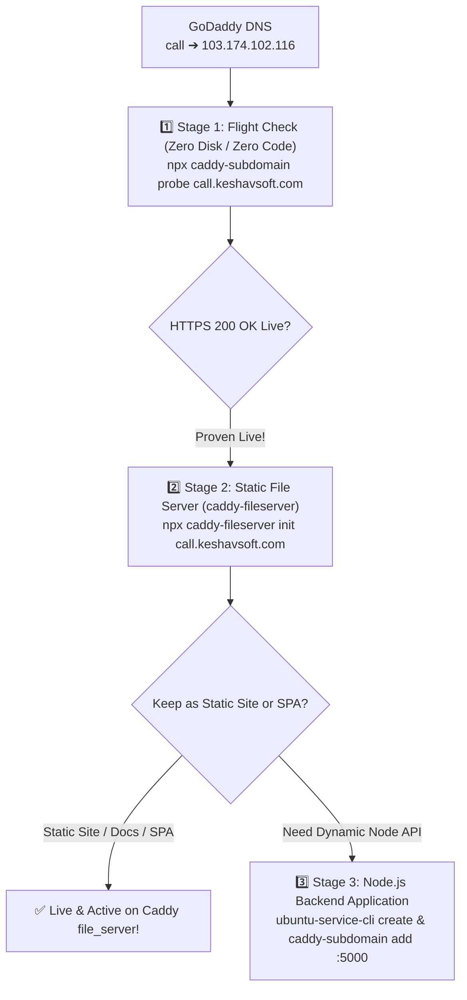

# Caddy Knowledge Base

[](https://keshavsoft.github.io/caddy-knowledge/)
[](https://github.com/keshavsoft)
[](LICENSE)
[](https://caddyserver.com)

> **The permanent, plain-English master handbook for the KeshavSoft Caddy Suite:**  
> Ingress architecture, automatic HTTPS, subdomains, reverse proxies, and static file servers on the KeshavSoft Ubuntu VPS fleet.

---

## 📖 Live Master Handbook & Runbooks

- 🌐 **Master Handbook**: [https://keshavsoft.github.io/caddy-knowledge/](https://keshavsoft.github.io/caddy-knowledge/)
- 🚀 **Operator Runbook (call.keshavsoft.com)**: [subdomain-to-fileserver-runbook.html](subdomain-to-fileserver-runbook.html) — Step-by-step instructions to inspect Caddy JSON and establish a static file server.

---

## 🧭 The 3-Stage VPS Subdomain Maturity Model

Never configure DNS, Node.js ports, Caddy routes, and SSL simultaneously. KeshavSoft decouples hosting into three progressive verification stages:



---

## 📦 The 4 Caddy Suite Repositories

| Repository | Responsibility | Key Commands |
| :--- | :--- | :--- |
| **[`caddy-subdomain`](https://github.com/keshavsoft/caddy-subdomain)** | Level-1 smoke probe & Level-2 promotion engine | `probe`, `add`, `static`, `check`, `list` |
| **[`caddy-fileserver`](https://github.com/keshavsoft/caddy-fileserver)** | Ubuntu filesystem (`/usr/share/...`) & static route automation | `init`, `check`, `template`, `list` |
| **[`caddy-template`](https://github.com/keshavsoft/caddy-template)** | Battle-tested route AST blueprints | `proxy`, `ws-split`, `static`, `multi-host` |
| **[`caddy-cli`](https://github.com/keshavsoft/caddy-cli)** | Fleet orchestrator, inspection table & port mapper | `caddy-cli`, `-p` (ports), `-d` (domain) |

---

## ⚡ Quick Decision Matrix

| Goal / Scenario | Recommended Command | Underlying Handler |
| :--- | :--- | :--- |
| **Verify GoDaddy DNS & SSL** | `npx caddy-subdomain probe <domain>` | `static_response (200 OK)` |
| **Host static site / SPA / docs** | `npx caddy-fileserver init <domain>` | `vars.root + file_server` |
| **Unified Node/Express app (:3000)** | `npx caddy-subdomain add <domain> 3000` | `reverse_proxy (dial: localhost:3000)` |
| **Split WebSocket (:8080) & REST (:9011)** | `npx caddy-template ws-split <domain> 9011 8080` | `subroute (/ws* ➔ :8080, * ➔ :9011)` |
| **Apex + WWW aliases** | `npx caddy-template multi-host domain.com,www.domain.com 9328` | `match.host: [domain1, domain2]` |
| **Audit all ports on VPS** | `npx caddy-cli -p` | Formatted route table |

---

## 🛠️ Emergency Runbook & Gotchas

### 1. 502 Bad Gateway
- **Cause:** Caddy received public traffic on `:443`, but the backend process is not listening on the internal target port.
- **Fix:** Check if the backend is running with `curl http://localhost:<port>` or `npx ubuntu-service-cli check <domain>`.

### 2. Hot-Reload Without Dropping Active WebSockets
Never run `systemctl restart caddy`. Use in-memory reload:
```bash
caddy reload --config /etc/caddy/caddy.json
```

### 3. Immediate Rollback from Automatic Backups
Every mutation creates an atomic backup file:
```bash
cp /etc/caddy/caddy.json.bak.<timestamp> /etc/caddy/caddy.json
caddy reload --config /etc/caddy/caddy.json
```

---

## 📄 License

ISC &copy; KeshavSoft
